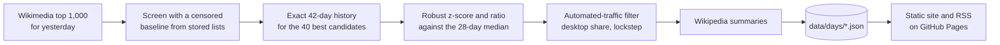

# Türkiye Trend Radar · Merak Radarı

[](https://github.com/NyksNightBender/trend-radar/actions/workflows/daily.yml)
[](https://github.com/NyksNightBender/trend-radar/actions/workflows/ci.yml)

**What did Türkiye suddenly look up yesterday?** Every morning this pipeline scans the 1,000 most-read pages on Turkish Wikipedia, compares each one with its own normal traffic, and publishes the pages that jumped far above it.

**Live site: [nyksnightbender.github.io/trend-radar](https://nyksnightbender.github.io/trend-radar/)** (in Turkish, with an archive and an RSS feed)

<!-- TODAY:START -->
**Biggest jumps on Turkish Wikipedia, 9 November 2026** ([full list](https://nyksnightbender.github.io/trend-radar/))

| # | Page | Views | Usual | Jump |
| ---: | --- | ---: | ---: | ---: |
| 1 | [Cevad Prekazi](https://tr.wikipedia.org/wiki/Cevad_Prekazi) · Kosovalı futbolcu | 62,060 | ~44 | 1241.2× |
| 2 | [Fatma Betül Sayan Kaya](https://tr.wikipedia.org/wiki/Fatma_Bet%C3%BCl_Sayan_Kaya) · Türk siyasetçi | 13,928 | ~1,602 | 8.7× |
| 3 | [Yol Ayrımı (film)](https://tr.wikipedia.org/wiki/Yol_Ayr%C4%B1m%C4%B1_%28film%29) · 2017 yapımı Yavuz Turgul filmi | 11,912 | ~42 | 238.2× |
| 4 | [Mehmet Rüştü Başaran](https://tr.wikipedia.org/wiki/Mehmet_R%C3%BC%C5%9Ft%C3%BC_Ba%C5%9Faran) | 8,123 | ~37 | 162.5× |
| 5 | [Mustafa Kemal Atatürk](https://tr.wikipedia.org/wiki/Mustafa_Kemal_Atat%C3%BCrk) · Türkiye Cumhuriyeti'nin kurucusu ve ilk cumhurbaşkanı | 8,965 | ~2,112 | 4.2× |
<!-- TODAY:END -->

## Why

Lists of the most popular pages are dull: Atatürk, Türkiye and Google top them every single day. The interesting signal is the *change*. A page that is normally read 400 times a day and suddenly gets 60,000 views means something happened: a match, a death, an earthquake, a series finale.

Finding those days is an anomaly detection problem. It is the same problem I work on in my TÜBİTAK 2209-A research on abnormal water consumption, applied here to about a thousand live time series a day.

## How it works



1. **Normal traffic** is the median of the page's previous 28 days. The median ignores the odd extreme day, unlike the mean.
2. **A spike** needs at least 2,000 views, at least 3 times the usual level, and a robust z-score of at least 5, where `z = (views − median) / (1.4826 · MAD)` and MAD is the median absolute deviation. Spikes are ranked by views above normal.
3. **Two passes keep the API load small.** Screening uses only the stored daily top lists. A page missing from a day's list had fewer views than that list's cutoff, so the cutoff is used as a right-censored upper bound. The baseline can then only be overestimated, which means screening never inflates a spike. Only the 40 strongest candidates get their exact history. That is about 45 requests a day instead of about 1,000.
4. **Automated-traffic filter.** Some bot traffic slips past Wikimedia's own filter. Two signs give it away:
   - *Desktop share.* Leaked bot traffic is overwhelmingly desktop, while real interest from Türkiye is mostly mobile. Spikes with less than 20% mobile views are set aside.
   - *Lockstep.* People don't spread themselves evenly over unrelated pages. When four or more pages gain the same number of extra views on the same day, to within 3%, one automated source is hitting them all. On 6 November 2026, for example, Tarih, Coğrafya, Sanat, Bilim, Teknoloji and İstanbul each gained about 5,900 views; the lockstep check removes that group.

   Removed pages are still listed at the bottom of each day.
5. Pages that are not articles (main page, search, categories) and adult content are left out.

**Schedule.** The workflow runs four times a day (00:37, 06:37, 12:37 and 18:37 UTC). The first run after Wikimedia publishes yesterday's data does the work and commits it; later runs see the day is done and stop. Missed days are caught up automatically.

## Data

| Path | What |
| --- | --- |
| `data/top/YYYY/YYYY-MM-DD.csv` | The raw daily top list: `rank, article, views` |
| `data/days/YYYY/YYYY-MM-DD.json` | The day's spikes with views, usual level, ratio, z-score, mobile share, summary and a 42-day history, plus suspected bots |
| [`api/latest.json`](https://nyksnightbender.github.io/trend-radar/api/latest.json) | The latest day, served by the site |

## Run it locally

```bash
uv sync
uv run trend-radar fetch                 # analyse yesterday (UTC) and any missed days
uv run trend-radar fetch --backfill 14   # also fill the previous 14 days
uv run trend-radar site                  # render the site into _site/
uv run pytest && uv run ruff check . && uv run mypy
```

Python 3.13, [uv](https://docs.astral.sh/uv/), httpx and Jinja2. The tests run the whole pipeline against a synthetic Wikipedia, so they need no network.

## Credits

Pageview data: Wikimedia Foundation, CC0. Article summaries: Wikipedia contributors, CC BY-SA 4.0. Code: MIT.
